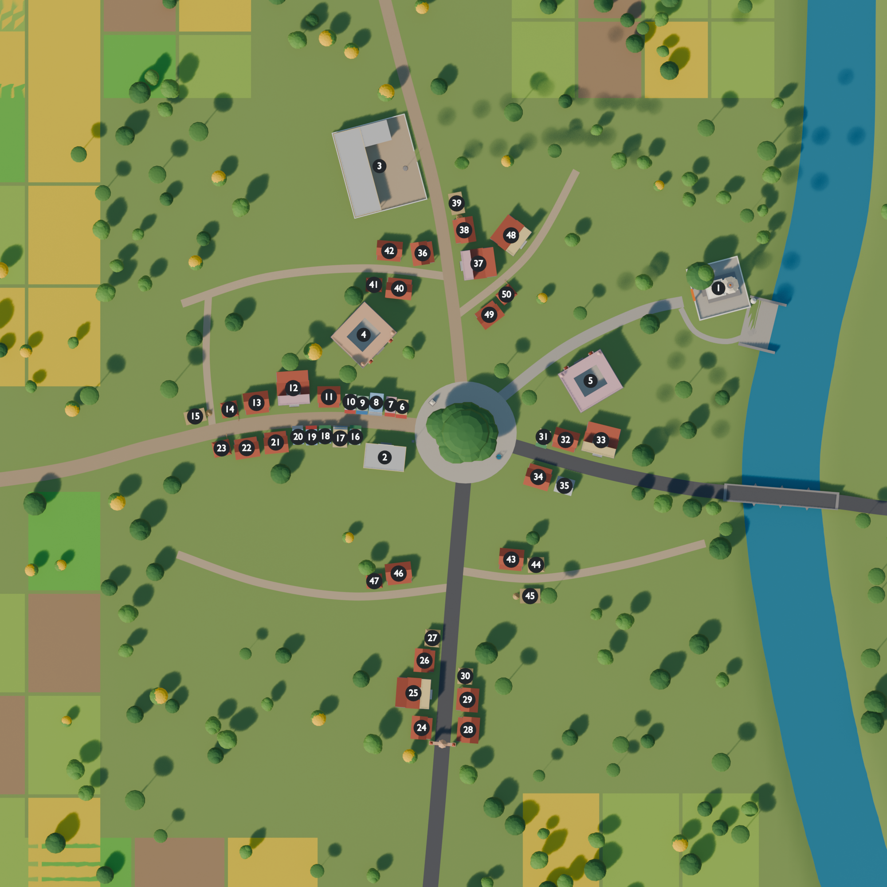

# AMALTASPUR — World Bible

_Status: **G0 / G1 pending approval** · Blockout v001 · last updated 2026-11-12_

Amaltaspur is a fictional village in modern India, named for the golden **amaltas** trees (golden shower trees) that flower along its lanes. It is a river valley settlement backed by hills to the north. The village sits on flat land between farmland and a river, with a stone ghat and a hilltop-style temple on its eastern edge. The architecture is traditional: lime-washed and clay walls, terracotta and thatch roofs, and a couple of havelis. Everyday life is contemporary: tar roads, shops with rolling shutters, a school and a panchayat office.

It is not a copy of any real town, any single regional style, or any film location.

Visual reference: `REFERENCE_MASTER_VISION.webp` (the user's concept board).

---

## 1. Technical conventions (locked at G0)

| Item | Convention |
|---|---|
| Blender | 5.3.0 (Windows) |
| Units | Metric, **1 BU = 1 m**, +X east, +Y north, +Z up |
| Origin | Centre of the chowk (banyan tree) |
| Human scale | Adult 1.55–1.80 m; door 2.1 m; storey 3.0–3.6 m; plinth 0.4–0.9 m |
| Review renders | EEVEE, AgX view transform, 1920×1080 (plan 2000×2000) |
| Final renders | Cycles + OptiX on RTX 3060 Ti (8 GB VRAM), denoised |
| Colour | AgX, sRGB output; palette hex values are sRGB |
| Memory budget | 16 GB system RAM: instance vegetation and props, keep hero assets separate |
| Rebuild | `00_MASTER/SCRIPTS/build_blockout.py` regenerates the master from `config_layout.py`; previous master archived to `99_ARCHIVE/` |
| Character import | FBX importer enabled (Mixamo workflow, Phase 4+) |

### Naming
`OBJ_House_Common_003`, `OBJ_Shop_Single_002`, `OBJ_Landmark_Temple_001`, `OBJ_Road_R02_Market_Street`, `INST_Tree_Neem_041`, `MAT_BLK_*` (blockout materials, to be replaced by `MAT_*` production materials), `CAM_Chowk_Wide_001`, `LGT_Sun_Afternoon`.
Every building carries custom properties: `plot_id`, `family`, `neighbourhood`, `status`.

### Collections
`ENV_TERRAIN · ENV_WATER · ENV_ROADS · ENV_FIELDS · ENV_VEGETATION · ENV_BACKDROP · BLD_HOUSES · BLD_SHOPS · BLD_UTILITY · BLD_LANDMARKS · PRP_ASSETS · INT_INTERIORS · CHR_HUMANS · CHR_ANIMALS · VEH_TRANSPORT · FX_ENVIRONMENT · LIGHTING_CAMERAS · REVIEW_LABELS (render-hidden) · PROTO_LIBRARY (excluded; instance sources)`

The `CHR_*`, `VEH_*` and `INT_*` collections exist but stay **empty until their gates**.

---

## 2. Visual bible

### Look
A semi-realistic stylised 3D cartoon at feature-animation quality. Not low-poly, not photoreal, not childish. Stylisation comes from **shape and proportion**, not noise.

### Shape language
- **Homes:** soft, slightly bowed silhouettes; generous roof overhangs; chunky plinths and steps. Every house sits on a visible plinth.
- **Landmarks:** strong verticals that read from anywhere in the village (temple shikhara, haveli chhatris, school flagpole, banyan canopy).
- **Asymmetry:** off-centre doors, one-sided boundary walls and lean-to additions break up repetition.
- **Silhouette test:** every building family must be identifiable as a flat black shape.

### Palette (sRGB)
| Role | Colours |
|---|---|
| Walls | lime white `#EDE5D3`, clay ochre `#B98758`, mud brown `#9E7653`, pastel blue `#8DB2C8`, pastel yellow `#E3C47D`, pastel pink `#D9A6A0`, mint `#A8C6A2`, sandstone `#D6A47A` |
| Roofs | terracotta `#A5523A`, thatch `#B69862`, concrete `#BDB5A8`, tin `#8C8F8E` |
| Accents | saffron `#E8761E`, awning red `#B4473A` / blue `#3D6F95` / green `#4F8452`, dark wood `#4A3426` |
| Ground | dry grass `#8A9452`, lush grass `#6F8C45`, dirt road `#B49A76`, tar `#57534F`, chowk stone `#B3A58E`, rock `#8A7E72` |
| Nature | water `#3C7884`, mango `#3E6A34`, neem `#5F8C3D`, banyan `#46733A`, palm `#557D3A`, **amaltas `#E9B923`** (signature) |
| Crops | mustard `#D8B72D`, wheat `#8EAA45`, paddy `#67A83F`, fallow `#9A7A55` |

Wealth is shown through **materials and upkeep**, not saturation. Poorer homes are mud and thatch with honest wear; wealthier homes are sandstone with carved detail. No home is drawn as a caricature of poverty.

### Materials (production pass, Phase 1b/2)
- Roughness 0.7–0.9 for plaster, mud and stone; 0.4–0.6 for tin and polished stone; water 0.05.
- Wear and grime only where it would really collect: plinth splash zones, under windows, roof drip lines, door handles.
- No plastic-looking walls, no tiling noise visible at medium distance.

### Lighting presets (to build in Phase 1b)
`DAY_Afternoon` (current: warm sun 56°/−40°, haze sky), `GOLDEN_Hour`, `DUSK_Lamps`, `NIGHT_Moon` (blue-silver with warm windows), `MONSOON_Overcast`, `SUSPENSE_Fog`, plus an interior kit.

### Camera conventions
| Shot | Lens | Notes |
|---|---|---|
| Establishing aerial | 24–35 mm | always include the river and the temple shikhara |
| Ground wide | 20–28 mm | eye height 1.6–1.7 m |
| Medium / dialogue | 35–50 mm | f/2.8–4 depth of field |
| Close-up | 75–100 mm | f/2 |

---

## 3. Village master plan

| Zone | Contents |
|---|---|
| **Chowk** (origin, r 23 m) | Banyan with stone chabutra, well, small shrine; havelis, panchayat and shops face it |
| **Market Street** (R02, west) | Continuous single and double-storey shopfronts, then houses, then the farm edge |
| **Main Approach** (R01, south, tar) | Entrance gate at about 140 m south of the chowk; houses line both sides |
| **Temple Road** (R03, NE, stone) | Haveli B, then the Shiv temple compound on a slight rise; ghat path down to the river |
| **Bridge Road** (R04, east, tar) | Shops and homes, then a 3-pier stone bridge over the river to the east-bank fields |
| **North Road** (R05) | School compound, homes, and the road climbing into the hills |
| **Lanes** L01–L05 | Residential lanes of mixed small and common homes, cattle sheds |
| **Farmland** | Mustard, wheat, paddy and fallow patches on all sides; east bank across the bridge |
| **Hills** | Rise north from about 250 m; a ring of hills closes the horizon |

### Plot mix (50 plots, full list in `PLOT_SCHEDULE.csv`)
| Family | Count | Notes |
|---|---|---|
| Landmarks | 3 | Temple (P01), Panchayat (P02), School (P03) |
| Havelis (rich) | 2 | P04 faces the chowk; P05 is on Temple Road |
| Middle courtyard homes | 5 | Two-storey front block around an open court |
| Common tiled homes | 17 | Veranda, gable terracotta roof |
| Small mud/thatch homes | 8 | Hip roof, low boundary walls |
| Shops | 11 | 9 single, 2 double-storey |
| Utility | 4 | 3 cattle sheds, 1 grain store |

Plus non-plot structures: entrance gate, bridge, ghat, chowk shrine, well, banyan, temple peepal.

Household and character assignments to plots happen in Phase 5. Plot IDs are stable from G1 onward.

---

## 4. Approval log
| Gate | Item | Status |
|---|---|---|
| G0 | Visual bible + project setup | **approved 2026-11-12** |
| G1 | Layout + blockout v001 | **approved 2026-11-12** (plot IDs P01-P50 now stable) |
| G3 sample | Hero common house v001 (quality benchmark) | **approved 2026-11-12**; user asked for the same quality on trees, water, bridge, ghat, ground |
